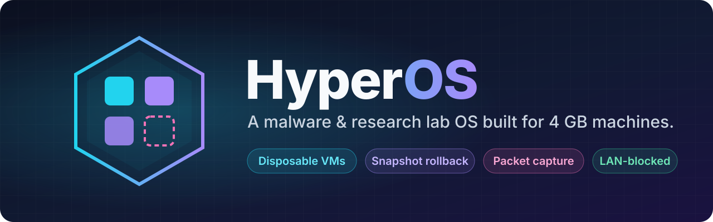
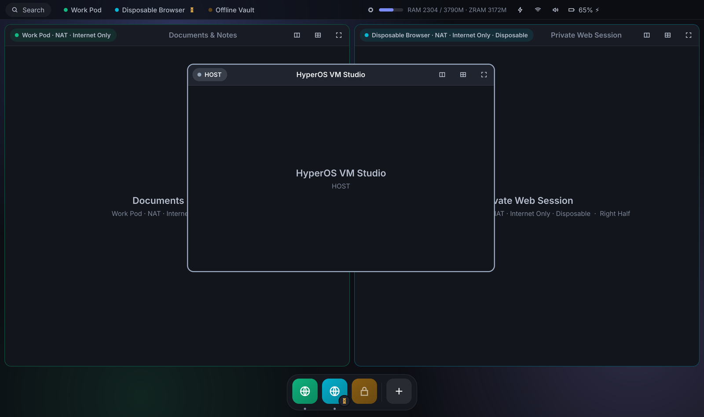
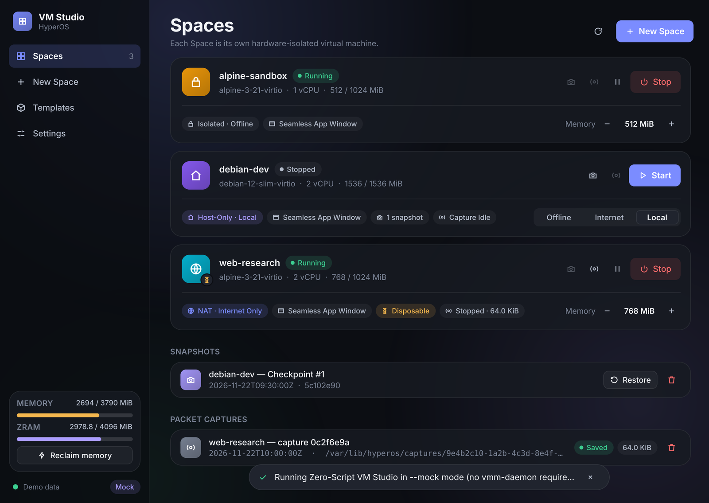
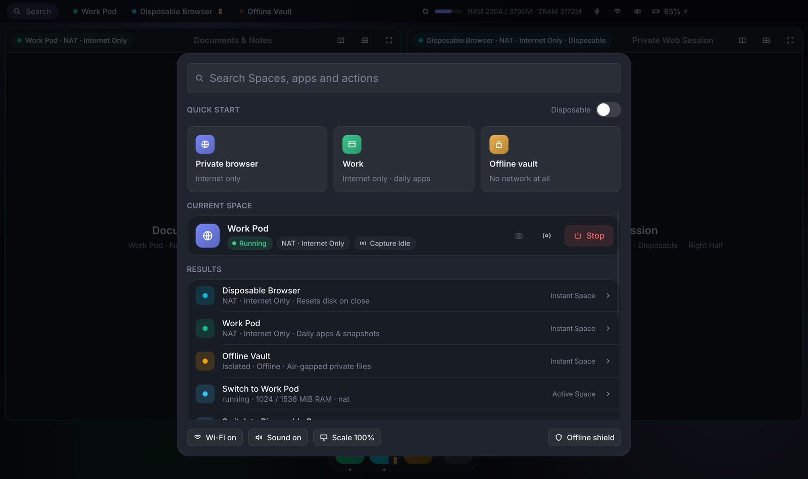
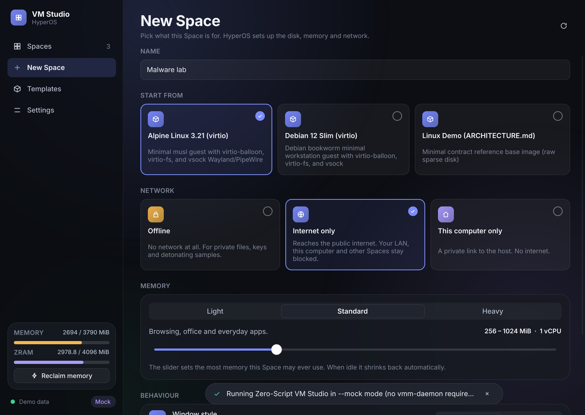
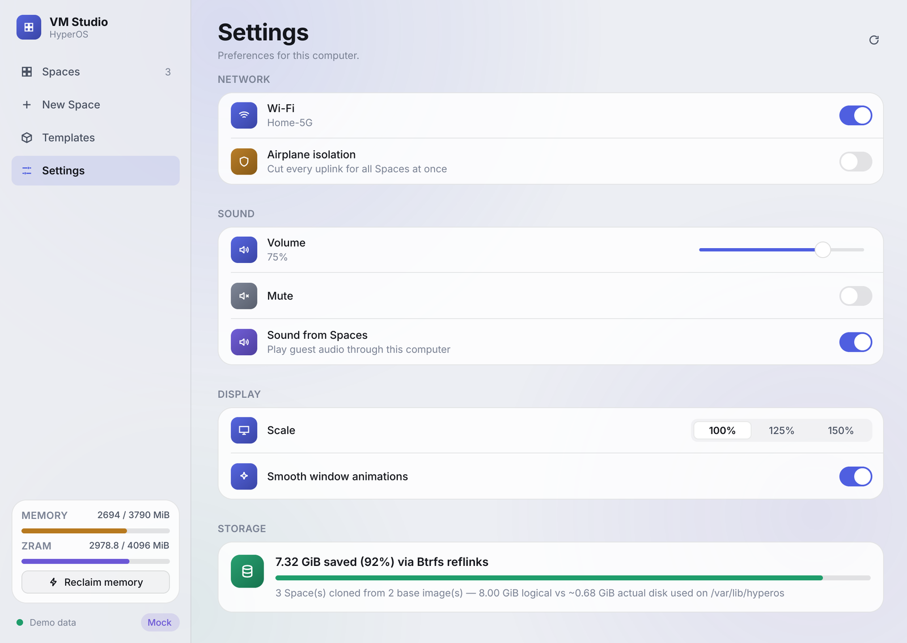
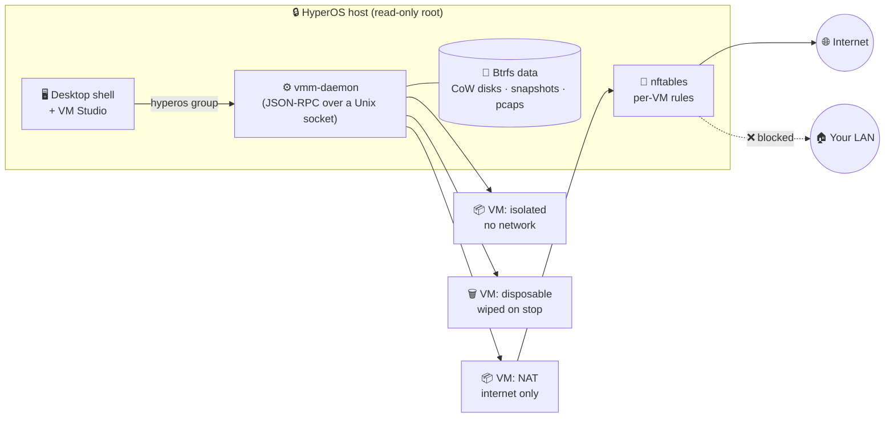

<p align="center">
  
</p>

<p align="center">
  <a href="https://github.com/1mos-droid/vm-os/releases/latest"></a>
  <a href="https://github.com/1mos-droid/vm-os/actions/workflows/build-os.yml"></a>
  <a href="https://github.com/1mos-droid/vm-os/actions/workflows/vmm-daemon-ci.yml"></a>
  
</p>

<p align="center">
  <b>Open a suspicious file in a VM that can't see your network, then throw the VM away.</b><br>
  HyperOS boots from a USB stick and runs every task in its own hardware-isolated <a href="https://crosvm.dev">crosvm</a> VM.
</p>

<p align="center">
  <a href="https://github.com/1mos-droid/vm-os/wiki"><b>📖 Wiki</b></a> ·
  <a href="#-quick-start"><b>🚀 Quick start</b></a> ·
  <a href="ARCHITECTURE.md"><b>📐 Architecture</b></a> ·
  <a href="https://github.com/1mos-droid/vm-os/releases"><b>📦 Releases</b></a>
</p>

---

## 🖥️ See it

<table>
  <tr>
    <td width="50%"></td>
    <td width="50%"></td>
  </tr>
  <tr>
    <td align="center"><sub><b>Desktop:</b> every window is edged in its Space's colour, drawn by the host</sub></td>
    <td align="center"><sub><b>VM Studio:</b> start, stop, snapshot and capture without a terminal</sub></td>
  </tr>
</table>

<details>
<summary>🔍 More: search launcher, new-Space flow, light theme</summary>
<br>

<br><br>

<br><br>

</details>

<sub>Rendered from the real UI code in mock mode. The look comes from <a href="ui-kit/README.md">Strata</a>, HyperOS's design system, inspired by macOS, GNOME, elementary OS and Windows 11.</sub>

## ✨ What you get

<table>
  <tr>
    <td width="33%" valign="top">
      <h3>🗑️ Disposable VMs</h3>
      Every change is thrown away when the VM stops or crashes. Next boot is factory fresh.
    </td>
    <td width="33%" valign="top">
      <h3>⏪ Snapshot rollback</h3>
      Snapshot a clean VM, detonate something, restore in one atomic step.
    </td>
    <td width="33%" valign="top">
      <h3>📡 Packet capture</h3>
      Record a VM's traffic to a <code>.pcap</code> straight from the UI. Opens in Wireshark.
    </td>
  </tr>
  <tr>
    <td valign="top">
      <h3>🛡️ LAN-blocked NAT</h3>
      Guests reach the internet, never your router, your other devices or each other.
    </td>
    <td valign="top">
      <h3>🔒 Immutable host</h3>
      Read-only compressed root, RAM overlay, no kernel modules, crosvm jail + seccomp.
    </td>
    <td valign="top">
      <h3>🪶 Built for 4 GB</h3>
      ZRAM swap, memory ballooning and copy-on-write disks keep the host small.
    </td>
  </tr>
</table>

## 🧭 How it works



## 📊 Status

| | |
| --- | --- |
| ✅ **Works in code and tests** | VM lifecycle · disposable VMs · snapshots · packet capture · LAN-blocked NAT · non-root GUI access · crosvm built from pinned source · guest import |
| 🚧 **Built, not yet hardware-tested** | Booting the image · starting a VM end to end · graphical session (off by default) · 350 MiB idle-RAM target |
| 🗺️ **Next** | crosvm as an unprivileged user · verified boot + A/B updates · CI boot test · theme & app catalog |

Full plan and progress: [`docs/REVIEW_FIXES.md`](docs/REVIEW_FIXES.md)

## 🚀 Quick start

> [!WARNING]
> Writing `hyperos.img` to a drive **erases it**. Use a spare USB stick or a scratch disk image.

**1. Check the repo** (no root, no downloads)
```sh
scripts/validate-configs.sh
```

**2. Build the image** (Buildroot 2025.02.1 · Linux 6.12.20 · Rust with the musl target)

<details>
<summary>Show the build commands</summary>

```sh
curl --fail --location --retry 3 \
  "https://buildroot.org/downloads/buildroot-2025.02.1.tar.xz" -o buildroot.tar.xz
echo 'a3216907e7ce1bbd38413e20b0861641b160ecc40dd7b598febb7f12984b3206  buildroot.tar.xz' | sha256sum -c -
mkdir -p buildroot && tar -xf buildroot.tar.xz -C buildroot --strip-components=1

export HOSTCC="$PWD/scripts/host-gcc-gnu17"
export BR2_CMAKE_CANDIDATES=""
make -C buildroot O="$PWD/output" BR2_EXTERNAL="$PWD/kernel-buildroot" hyperos_x86_64_defconfig
make -C buildroot O="$PWD/output" -j"$(nproc)"
scripts/validate-configs.sh --image output/images/hyperos.img
```
</details>

**3. Add a guest and start it**
```sh
sudo guest-images/build-alpine-guest.sh --out-dir out
sudo scripts/import-guest-image.py out/alpine-3-21-virtio output/images/hyperos.img
# then, inside the booted HyperOS:
hyperos-vm alpine-3-21-virtio
```

**Or do it all in QEMU with one command** (needs `/dev/kvm`):
```sh
sudo scripts/test-v1-release.sh --image output/images/hyperos.img
```

More detail: [Getting started on the wiki](https://github.com/1mos-droid/vm-os/wiki/Getting-Started) · [Cloud / nested-KVM testing](docs/CLOUD_TESTING.md)

## 📚 Learn more

| I want to… | Go to |
| --- | --- |
| Understand the design | [Wiki: Architecture](https://github.com/1mos-droid/vm-os/wiki/Architecture) · [`ARCHITECTURE.md`](ARCHITECTURE.md) |
| Drive VMs from code | [Wiki: VM API](https://github.com/1mos-droid/vm-os/wiki/VM-API) |
| Know what's isolated from what | [Wiki: Security model](https://github.com/1mos-droid/vm-os/wiki/Security-Model) · [`SECURITY.md`](SECURITY.md) |
| Hack on the code | [Wiki: Development](https://github.com/1mos-droid/vm-os/wiki/Development) · [`CONTRIBUTING.md`](CONTRIBUTING.md) |

<details>
<summary>📁 Repository layout</summary>

```text
kernel-buildroot/   Buildroot tree: kernel, initramfs, boot, packages, services
vmm-daemon/         Rust daemon that runs crosvm VMs over a Unix-socket API
desktop-shell/      Wayland compositor (Smithay + Slint), DRM/KMS backend
vm-control-ui/      VM Studio GUI (Slint)
ui-kit/             Strata design system shared by both UIs (components, Inter font)
guest-images/       Reproducible Alpine & Debian guest builders
scripts/            Validator, guest import, end-to-end release runner
docs/               Plan, testing guide, proposals, images
```
</details>

## 🤖 Credits

v0.2.0 was built by three AI coding agents working from one plan, reviewed by the maintainer.

| | Agent | Built |
| :-: | --- | --- |
| 🟠 | **Claude** (Anthropic) | API contract v2 · LAN-blocked NAT · non-root socket access · disposable VMs · snapshots · packet capture |
| 🟢 | **Codex** (OpenAI) | crosvm from pinned source · KSM off · guest import & one-command boot · UI packaging · verified-boot design |
| 🔵 | **Antigravity** (Google) | KMS desktop shell & VM Studio · non-root connection · research UI · data-only themes · app manifest proposal |

Each commit names its author agent in a `Co-Authored-By` trailer.

## 🤝 Contributing · 🔐 Security · ⚖️ License

- **Contributing:** read [`CONTRIBUTING.md`](CONTRIBUTING.md) and the [Code of Conduct](CODE_OF_CONDUCT.md).
- **Security:** report vulnerabilities privately; see [`SECURITY.md`](SECURITY.md).
- **License:** dual-licensed under [MIT](LICENSE-MIT) or [Apache-2.0](LICENSE-APACHE), at your option. Upstream components (Linux, Buildroot, GRUB2, runit, nftables, iproute2, crosvm) keep their own licenses; the bundled Inter font is under the SIL Open Font License (`ui-kit/fonts/OFL.txt`).
